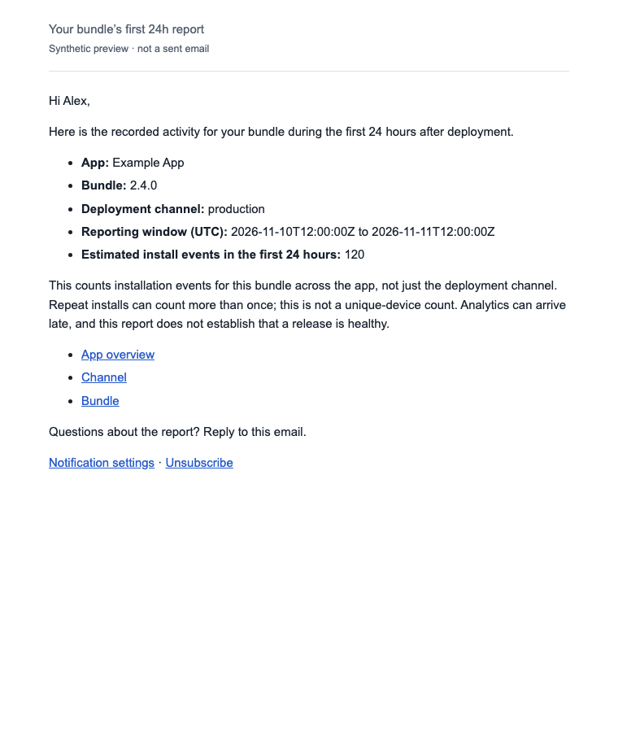
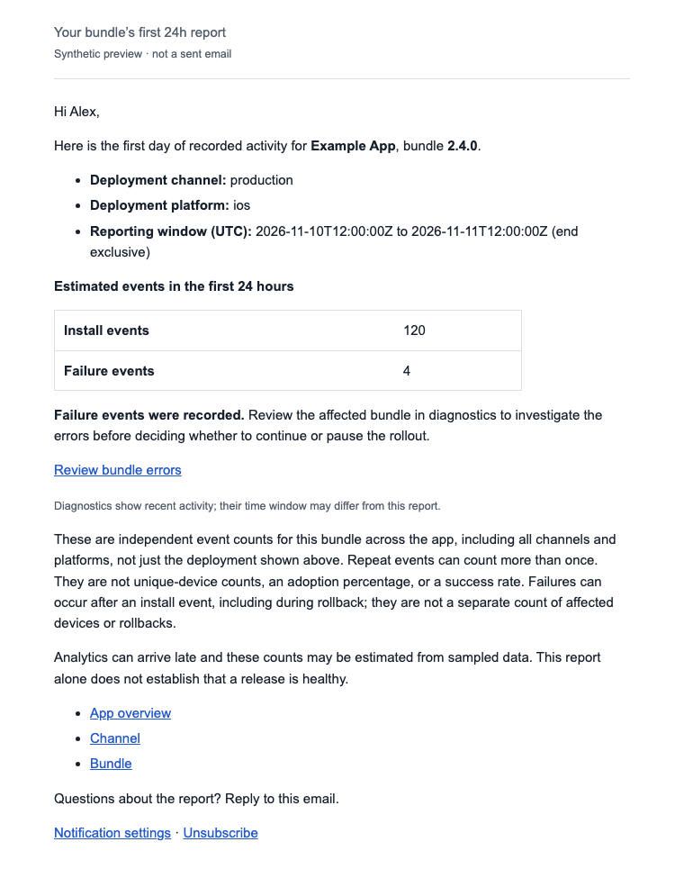
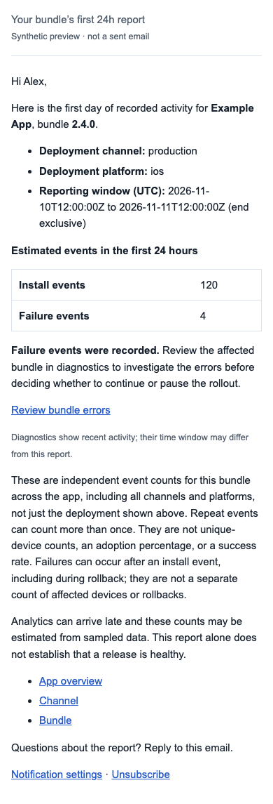

# First-day bundle report

Bento template **85726**, subject **Your bundle’s first 24h report**, consumes
`bundle:install_stats_24h`. Its source is
[`deploy_report_24h.html`](../supabase/templates/bento/deploy_report_24h.html).

Schema v3 adds `failure_count_24h`, a validated nonnegative integer encoded as a
string. Both install and failure counts use the same bundle and first 24-hour
window `[deployed_at, deployed_at + 24h)`. Matching includes legacy numeric bundle
IDs. Counts are app-wide across channels/platforms and may be sampling estimates;
they are independent events, not unique devices, adoption, rollback totals, or a
success rate. The deployment channel and platform are context, not counter filters.

The existing analytics query corrects legacy update-check failures misclassified
as download failures. Report reads now require that correction to succeed, including
its provider/configuration and numeric validation. Errors release the claim for the
existing hourly producer to retry within 48 hours. Dashboard fallback behavior stays
unchanged. No new database jobs or additional analytics queries are introduced.

A report is eligible with more than one install **or any failure event**. Zero/one
installs with zero failures still defer; no-activity reports are not introduced.
Existing recipient preferences, suppression, claim ownership and final deployment
state checks remain in place.

## Deployment

Repository template changes are **not uploaded to Bento automatically**.

1. Review the template and its synthetic previews below. Render locally with
   `bun scripts/email-previews/deploy-report-24h.ts`; this does not send email.
2. Upload the reviewed HTML to Bento template 85726 using Bento MCP. Keep the
   existing subject. Read it back to verify the saved body.
3. Deploy the backend PR. No SQL migration is needed.
4. Check post-deployment dated workflow statistics and qualifying v3 event data
   where read access permits. Do not replay events or bypass suppression to test.

The template can be uploaded before the backend: older v2 events display
**Failure data was not included**, never a fabricated zero. If backend deployment
happens first, the old template ignores the new field until the template upload.
The diagnostics link filters by bundle, but its recent-activity time window may
differ from the emailed first-day window; the email says so explicitly.

## Synthetic screenshots

These render the saved HTML with fictional app data, not customer messages. The
local wrapper supplies a neutral email-client font and subject line; it does not
simulate every inbox provider or guarantee inbox placement.

### Before

### After

