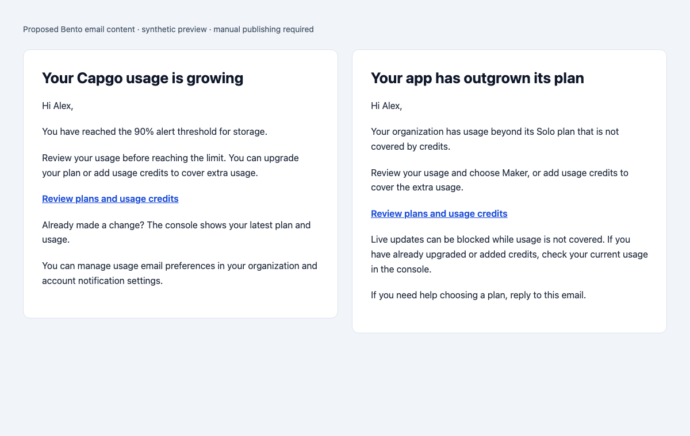

# Billing notification review

The backend sends the same billing events for both Stripe accounts. Account selection uses the stored `billing_account` and each webhook's signing secret; it must not use the recipient's location or the account's default country.

## Changes

- Reject the Stripe webhook with HTTP 503 when any Bento dunning submission fails or returns an ambiguous result. Persist the failed billing state before sending, so email outages do not hide it from the console. Logs distinguish provider acceptance from inbox delivery and include the billing account and Stripe event identifier.
- Usage credits no longer suppress failed subscription payment alerts. A successful credit purchase no longer emits subscription recovery. Credits cover usage, not unpaid subscription invoices.
- Send usage alerts to organization administrators and billing administrators, preserving notification preferences and existing monthly/weekly throttles.
- Supply the scalar `percent` string expected by the existing 50/70/90-percent email, keep detailed metrics in `usage`, and provide the upgrade template's `best_name`.
- Supply an organization-specific `plans_url` for usage and upgrade emails.

## Manual Bento publishing

Repository changes do not publish Bento templates. After deploying the backend, copy the proposed bodies and subjects into the existing shared usage and upgrade email templates:

- `usage.html`: shared 50/70/90-percent usage email.
- `upgrade.html`: shared plan-upgrade email. This replaces the obsolete `/dashboard/settings/organization/plans` link with `event.details.plans_url`, falling back to `/settings/organization/plans` for older events.

Keep existing workflow event triggers, delays, and unsubscribe/envelope settings. Preview with synthetic events for each threshold and upgrade tier before publishing. The screenshot is a synthetic rendering of the proposed content, not an inbox delivery or a screenshot of a deployed console change.

## Coverage and remaining verification

The console already mounts `PastDueBanner` in the shared dashboard shell, including nested app and settings pages. Payment actions require `org.update_billing`; native App Store contexts suppress external purchase flows. This change does not widen billing access or add new console UI. Usage and upgrade emails complement the existing billing screens.

Live Bento template statistics show prior sends and engagement, but template-level totals do not prove that a particular invoice triggered an email, reached an inbox, or was routed through the correct workflow. Check both Stripe accounts' webhook delivery failures and retry settings, then correlate `stripe_event_id` and `billing_account` with Bento events. An active cancellation during an already-paid period is not itself an unpaid invoice.

Webhook delivery remains at least once: a retry after partial Bento acceptance can repeat events for recipients whose first submission succeeded. Existing workflows must handle repeated Stripe events; this change does not claim exactly-once email delivery or add a queue/retry budget. Missing Bento configuration still disables delivery for local/self-hosted setups. This PR does not establish the cause of a production account-health increase or change live Stripe/Bento settings.
