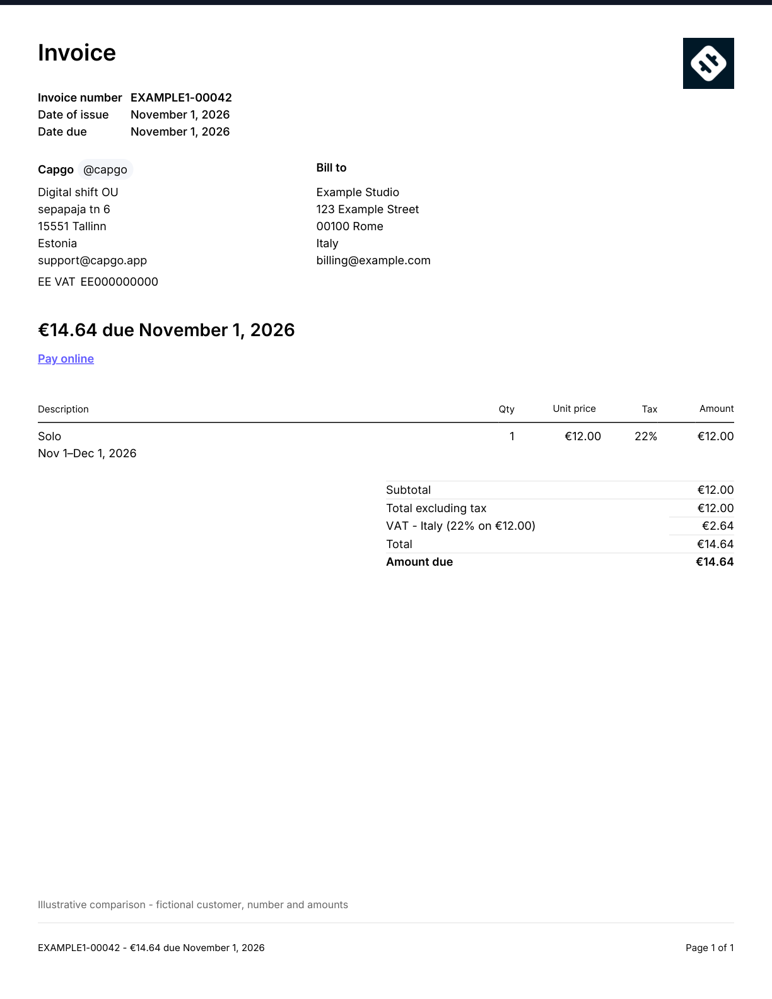
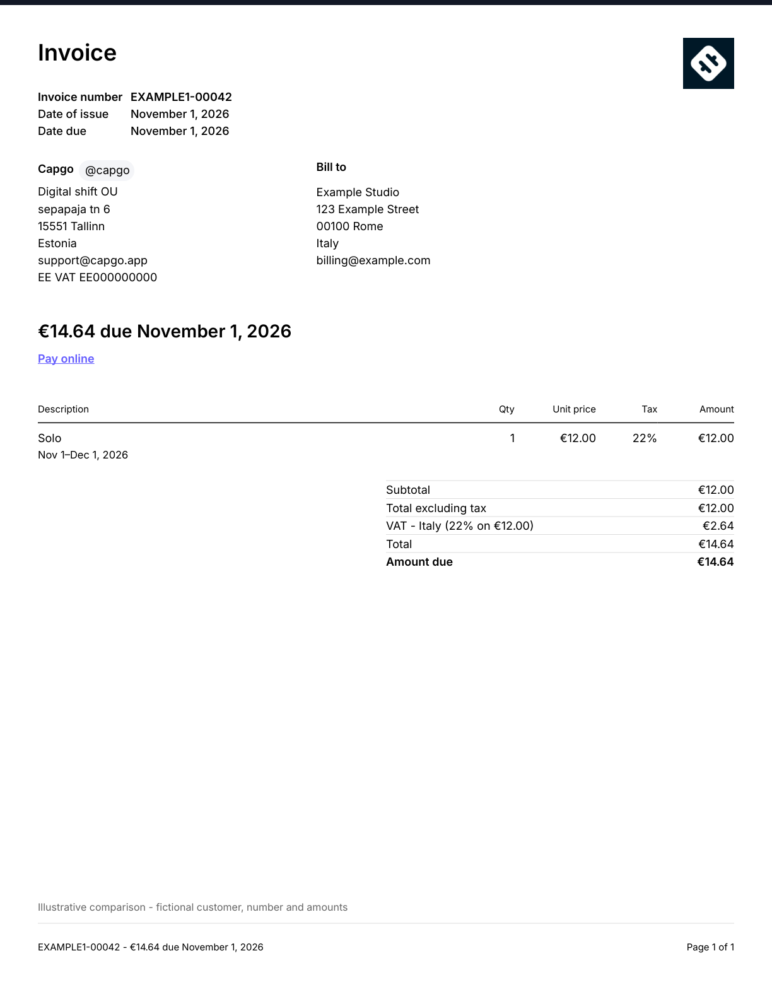

# Capgo invoice documents

The billing page generates its own PDF when a customer selects **PDF**. The
layout matches the existing Stripe invoice: US Letter paper, Inter typography,
Capgo logo, compact address blocks, line-item tax column, totals and footer.
The earlier [worker-invoices](https://github.com/Cap-go/worker-invoices/blob/main/src/pdf.ts)
project informed the implementation; the final renderer uses the issued Stripe
PDF as its visual reference and loads locally on demand.
No customer data is sent to a PDF service.

Stripe still owns subscriptions, taxes, payments, and finalized invoice records.
The document uses the finalized Stripe invoice number verbatim, including its
prefix and zero padding. Stripe continues advancing the existing EE or US
sequence. There is no new numbering scheme, counter reset, or duplicate invoice
issuance. Disabling Stripe's subscription invoice creation is not part of this
change: [subscriptions automatically generate invoices](https://docs.stripe.com/invoicing).

The authenticated `private/stripe_billing/invoice-document` endpoint requires
`org.read_invoices`, resolves the customer and Stripe account server-side, then
checks that the requested invoice belongs to that customer. It returns only the
document fields, with `Cache-Control: private, no-store`. It does not return
Stripe payment URLs or private metadata. Drafts cannot be downloaded. Line items
are paginated, with a 1,000-line bound that fails explicitly instead of producing
a partial invoice.

Customer names and same-country address corrections are read from the saved
billing profile whenever an invoice is downloaded. Email, periods, discounts,
credits, taxes, totals and payment status come from the issued invoice record.
Seller contact/address come from the issuing Stripe account; seller tax IDs are
those referenced by the invoice. Updating the seller's account address can change
its address on a downloaded PDF, so retain previously issued documents when
changing legal details. Existing account routing and invoice-history scope are
unchanged; this does not merge historical invoices between Stripe entities.

The renderer embeds Inter 4.1 (SIL Open Font License; see
`public/invoice/INTER-LICENSE.txt`) and supports its Latin, Greek and Cyrillic
glyphs. Additional script fonts are not bundled. PDF regressions cover accented
names, long descriptions and automatic multi-page layout.

## Billing details and country boundaries

Customers use the ordinary invoice number or PDF link. Every download reads the
saved billing details; there is no separate regeneration action or details mode.
The endpoint requires `org.read_invoices` and `org.read_billing`, checks invoice
ownership, and reads only the server-resolved customer's profile and tax IDs.
Caller-supplied replacement identities, addresses and tax IDs are ignored.

An issued invoice's billing and tax countries remain fixed:

- A saved address replaces the printed address only when its country matches the
  issued billing country. A moved, incomplete or missing address retains the
  issued address. Missing historical country data is never inferred from today's
  profile.
- An existing tax number can be replaced only by a single saved ID of the same
  tax type and country. Different-country, different-type, ambiguous, removed or
  unknown-jurisdiction IDs retain the issued number. For EU VAT, the number's
  prefix identifies the country, including Greece (`EL`) and Northern Ireland
  (`XI`); see [Stripe's tax ID formats](https://docs.stripe.com/tax/invoicing/tax-ids).
- When the invoice has no tax IDs, saved IDs can be added only if they belong to
  its original billing country. Without an issued country, no ID is added.

The issued number, dates, tax treatment, line items, payments and amounts are
never recalculated or rewritten. Adding a VAT number does not retroactively apply
reverse charge or issue a refund. Future billing profile changes do not change
these boundaries on historical invoices. A deleted customer retains the issued
details; a failed profile read returns an error instead of serving stale data.

## Comparison

Both examples use fictional customer details, invoice number, and amounts.
The before image preserves the Stripe layout with identifying content replaced;
it is published as a newly rasterized PDF to remove source metadata, hidden text,
links, and attachments. No original customer PDF is committed. The after PDF is
produced by the same renderer as the billing download.

| Before: Stripe | After: Capgo |
| --- | --- |
|  |  |

[Before PDF](pr-screenshots/owned-invoices/before.pdf) ·
[After PDF](pr-screenshots/owned-invoices/after.pdf)

Regenerate the after PDF with `bun scripts/generate-invoice-example.ts`.

## Legacy billing domain

`pay.capgo.app` was the Estonian Stripe custom domain for checkout, payment links,
and the customer portal. On November 16, 2026 it was removed from that Stripe
account, and Cloudflare was configured as follows:

- Single Redirect: `Legacy Stripe billing to Capgo`.
- Match: `(http.host eq "pay.capgo.app")`.
- Static 301 destination: `https://console.capgo.app/settings/organization/billing`.
- Do not preserve the path or query string: old Stripe session tokens are not
  Capgo credentials and must not be forwarded.
- DNS: `pay` is a proxied A record targeting `192.0.2.1`; the redirect terminates
  the request at Cloudflare without an origin connection.

Mail-related DNS records were left intact. This is a live configuration change,
independent of merging this PR. A request to an old `/p/` path was checked and
returned the exact 301 destination above. Old links cannot identify the Capgo
organization from opaque Stripe tokens: users authenticate and use the console's
organization selector. New PDF payment links include the authorized org ID.

## Rollout

Merge and deploy the API and frontend together. Verify a billing-admin download
and an unauthorized request in the deployed environment. This PR does not
change invoice email delivery settings or send emails. Review any Stripe invoice
email shutdown separately after the replacement is deployed, so customers do
not lose their existing invoice delivery before the new download is available.
