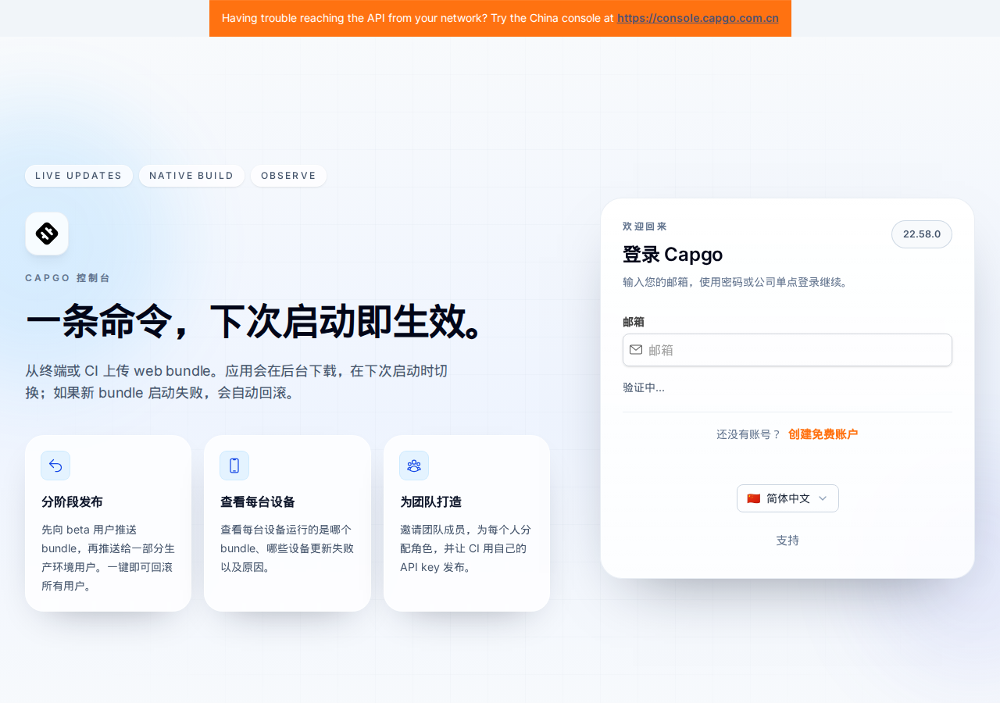
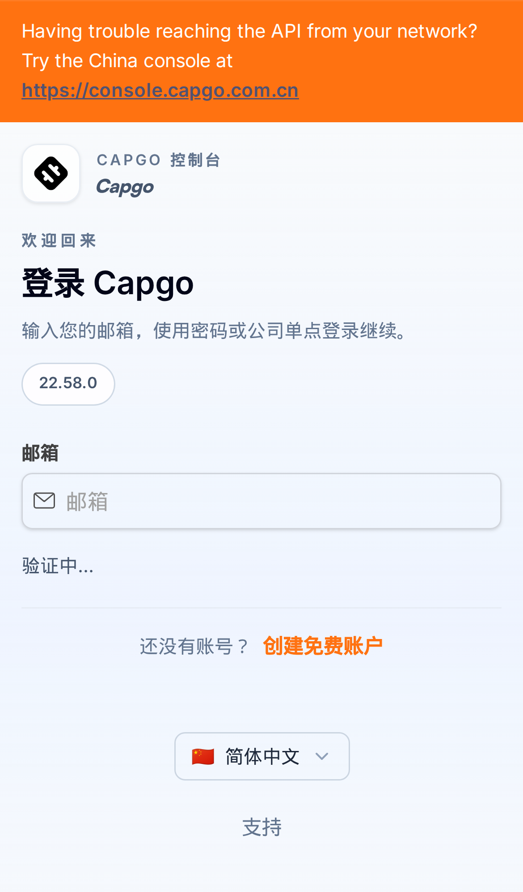
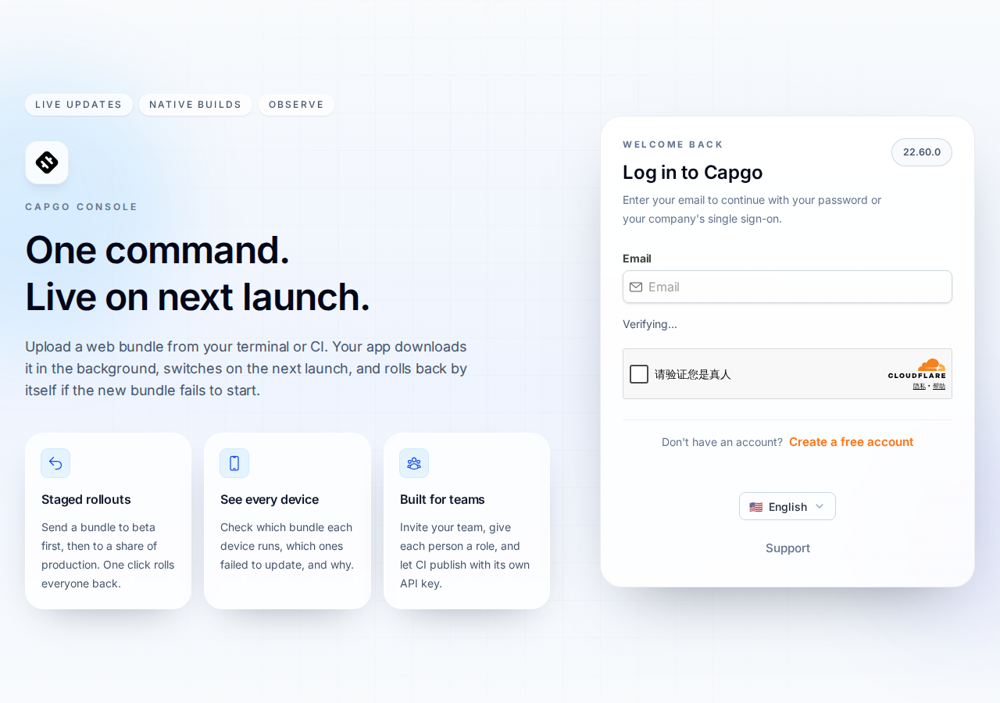
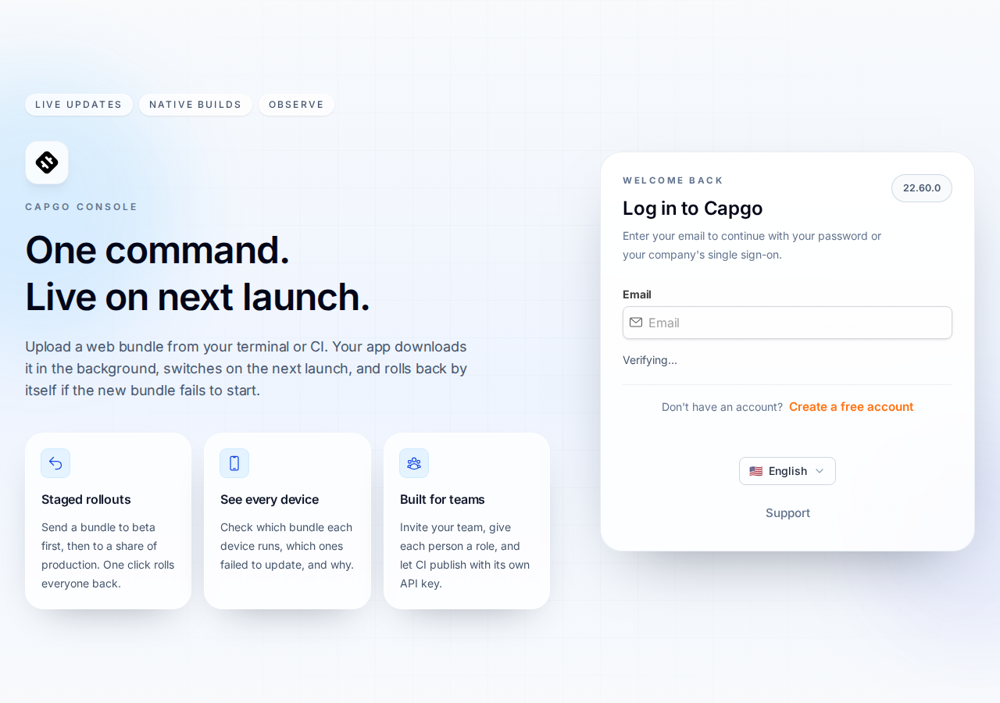
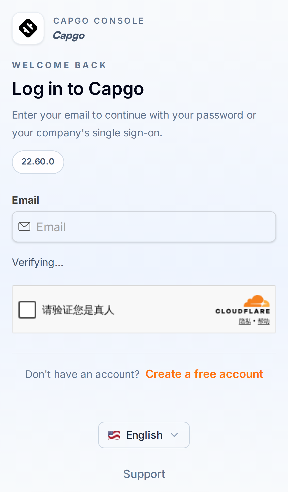
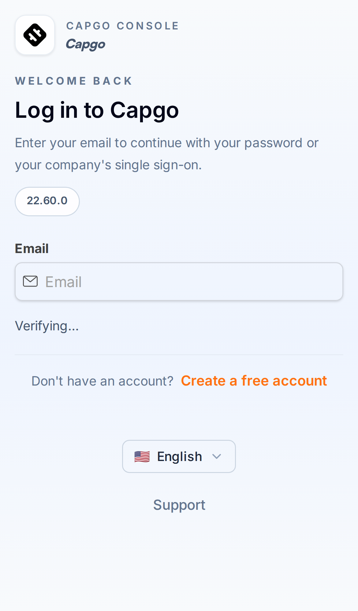
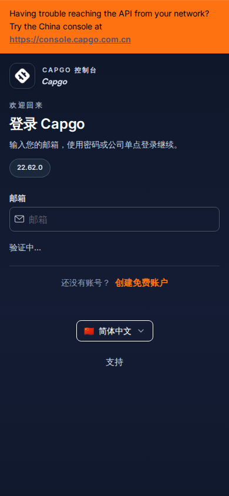
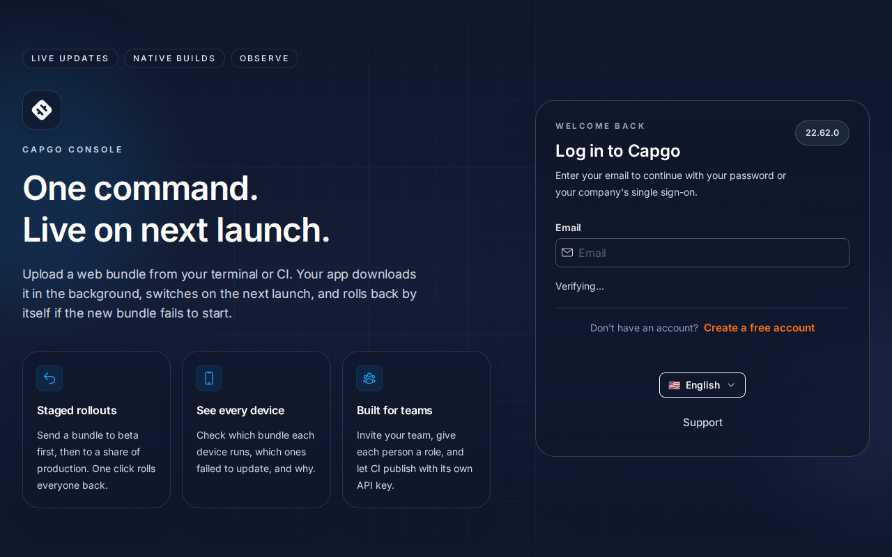

## Summary (AI generated)

- Add Worker routes on zone `capgo.app`: `console.capgo.com.cn/*` to `capgo_webapp-prod` and `api.capgo.com.cn/*` to `capgo_api-prod`, plus **more specific** `api.capgo.com.cn` paths on `capgo_plugin-eu-prod`, `capgo_files`, and `capgo_translation` (files, updates, plugin, channel_self, stats, translation) matching `api.capgo.app`.
- Keep a single `console.capgo.app` Workers Custom Domain on `capgo_webapp-prod` (`console.capgo.com.cn` uses `zone_name: capgo.app`, not `custom_domain`).
- Resolve console API host at runtime: hostnames under `.capgo.com.cn` (label boundary) call `https://api.capgo.com.cn`, otherwise `VITE_API_HOST`.
- CSP `connect-src` includes `https://api.capgo.com.cn` (generated via `scripts/console-security-policy.ts` and `bun run security:sync-headers`).
- Shared console web origins (`console_web_origins.ts`): CORS helpers, `validate_password_compliance`, and Stripe redirect URLs accept `https://console.capgo.com.cn`.
- China suggestion banner: web only on `console.capgo.app` (web `localhost` in dev), never Capacitor or `console.capgo.com.cn`; needs main `api.capgo.app` `/private/config` failure **and** successful `api.capgo.com.cn` probe (4s on probe only) plus China locale/timezone hints; app shell layout avoids clipping.
- CLI snippets on the China console keep `--api-host https://api.capgo.com.cn` (gate on `config.apiHost !== PROD_API_URL`), including Builder `build init` copy commands via shared `buildInitCliCommand`.
- Console client, auth relay, and `getLocalConfig().apiHost` follow `getConsoleApiHost()` on `console.capgo.com.cn` even when `VITE_API_HOST` is `https://api.capgo.app` (`tests/console-china-api-routing.unit.test.ts`).
- Native password recovery uses `VITE_APP_URL`, not Capacitor localhost.
- Reverted unrelated `bun.lock` CLI version bump from local `bun install` (no dependency change in this PR).

**HEAD:** `9fddbcd104` (CodeRabbit thread fixes).

## Motivation (AI generated)

From mainland China, `*.capgo.app` is often blocked or TLS-reset on the real Cloudflare edge IP (SNI filtering), while `.capgo.com.cn` hostnames on the SaaS fallback work. Console login currently hard-codes `api.capgo.app`, so config and auth refresh fail in the browser. PR #4064 only fixed captcha fallback origins for `.app`.

### Globalping probes (China) (AI generated)

| Host | Result |
| --- | --- |
| `updater.capgo.com.cn/ok` | 9/10 HTTP 200 |
| `console.capgo.app` | 10/10 HTTP 200 (shell may load; API calls still fail in browser) |
| `api.capgo.app` | 0/10: poisoned DNS and/or TLS reset on Cloudflare IP `172.66.40.90` (SNI filtering) |

**DNS CNAME chase (China resolvers, 8 nodes):**

- CNAME target `plugin.capgo.app`: 8/8 correct IPs ([Globalping measurement](https://globalping.io/?measurement=2zDBO9b8jr8Psjm3h00021WAi))
- CNAME target `api.capgo.app`: 0/8 correct ([Globalping measurement](https://globalping.io/?measurement=2ZZNDOAObPLReK2Et00021WAi))

Production reference today: AliDNS **CNAME** `updater.capgo.com.cn` -> **`plugin.capgo.app` only** (never `api.capgo.app` or `console.capgo.app` in the chain).

## Screenshots (AI generated)

### Global console banner (historical capture, localhost host)

These PNGs were taken before `isOnGlobalConsoleWebHost()` limited the banner to web `console.capgo.app` (web `localhost` in dev only). Capture setup: production build on Vite preview with browser hostname `localhost`, Playwright mocked failing `api.capgo.app` `/private/config`, successful `api.capgo.com.cn` probe, and `zh-CN` locale. Current code does not show the banner on localhost production preview; use `console.capgo.app` for production banner UX.

### China console hostname (`console.capgo.com.cn`)

DNS is not live yet. Shots use a production build (`bun run build`), `bunx vite preview --host 127.0.0.1 --port 4173`, and Playwright with Chromium:

- `--host-resolver-rules=MAP console.capgo.com.cn 127.0.0.1` so the browser hostname is `console.capgo.com.cn` while traffic stays on the local preview server.
- `--unsafely-treat-insecure-origin-as-secure=http://console.capgo.com.cn:4173` plus a `crypto.randomUUID` init-script polyfill (the console auth client needs a secure context on the custom host).

**Before:** abort `https://api.capgo.com.cn/private/config` (API unreachable from the page). **After:** mocked successful `/private/config` and empty console auth responses so the guest login form renders.

## Business Impact (AI generated)

Enables mainland customers to use the Capgo console and API on hostnames that bypass `.capgo.app` blocking. CLI and mobile SDK defaults stay on `api.capgo.app` (follow-up).

## Third party reachability from China (AI generated)

| Service | Console on `.capgo.com.cn` | Notes |
| --- | --- | --- |
| Capgo API (`api.capgo.com.cn`) | In scope of this PR | Routed on Workers after DNS |
| PostHog (`psthg.capgo.app`, `eu.posthog.com`) | **Unverified** | CSP still allows these hosts; mainland reachability not probed in CI |
| Stripe.js / Checkout | **Unverified** | Same CSP as global console; Stripe account may block CN cards |
| Cloudflare Turnstile | **Unverified** until hostname allowlist | Owner action below |
| OAuth / SSO (GitHub, etc.) | **Unverified** | IdP availability from mainland not tested here |
| Supabase Auth email links | **Requires redirect URL allowlist** | Owner action below (prod uses hosted Supabase Auth, not the test GoTrue worker) |

## Allowlist changes in this PR (AI generated)

| Location | Change |
| --- | --- |
| `scripts/console-security-policy.ts` / `public/_headers` | `connect-src` includes `https://api.capgo.com.cn` |
| `supabase/functions/_backend/utils/console_web_origins.ts` | Default console origins include `https://console.capgo.com.cn` |
| `supabase/functions/_backend/private/validate_password_compliance.ts` | Uses shared console web origins |
| `supabase/functions/_backend/utils/stripe.ts` | Checkout/portal redirect URLs may target China console origin |
| `supabase/functions/_backend/utils/hono.ts` and `plugin_runtime/utils/hono.ts` `DEFAULT_CORS_ALLOWED_ORIGINS` | `https://console.capgo.com.cn` (plugin `/serving_policy` from the console) |
| `supabase/functions/_backend/private/console_captcha_fallback.ts` | `DEFAULT_CAPTCHA_FALLBACK_ALLOWED_ORIGINS` |
| `cloudflare_workers/gotrue/wrangler.jsonc` `GOTRUE_URI_ALLOW_LIST` | Test GoTrue worker only (not production auth) |
| `src/utils/safeRedirect.ts` | `console.capgo.com.cn` and `api.capgo.com.cn` |
| Frontend runtime | `getConsoleApiHost()` / `getConsoleWebOrigin()` / China banner + probe tests |

No new secrets or env vars.

## Owner actions (not in this PR) (AI generated)

`capgo.com.cn` is on **AliDNS**, not Cloudflare DNS. Use **Workers routes on zone `capgo.app`** plus **Cloudflare for SaaS Custom Hostnames** on zone `capgo.app`. Do **not** CNAME any `.capgo.com.cn` name to `api.capgo.app` or `console.capgo.app`: mainland resolvers forge answers when the chain touches `*.capgo.app`. Always terminate the CNAME at **`plugin.capgo.app`** (same as `updater.capgo.com.cn`). Worker routes in this PR route by **HTTP Host** (`api.capgo.com.cn` vs `console.capgo.com.cn` vs `updater.capgo.com.cn`).

### Supabase Auth (production)

In the hosted Supabase project (Auth URL configuration), add **`https://console.capgo.com.cn/**`** to **Redirect URLs** (site URL may remain `https://console.capgo.app`). Recovery and confirmation emails must be allowed to return to the China console.

### Reference: `updater.capgo.com.cn` (already live)

| Layer | Action |
| --- | --- |
| AliDNS | **CNAME** `updater.capgo.com.cn` -> **`plugin.capgo.app`** |
| Cloudflare zone `capgo.app` | **Custom Hostname** `updater.capgo.com.cn` (SSL for SaaS, DV), fallback origin **`plugin.capgo.app`** |
| Workers | Route `updater.capgo.com.cn/*` -> `capgo_plugin-eu-prod` (`zone_name: capgo.app` in wrangler) |

### `api.capgo.com.cn`

| Layer | Action |
| --- | --- |
| AliDNS | **CNAME** `api.capgo.com.cn` -> **`plugin.capgo.app`** (not `api.capgo.app`) |
| Cloudflare zone `capgo.app` | **Custom Hostname** `api.capgo.com.cn`, fallback origin **`plugin.capgo.app`** |
| Workers | After deploy: `api.capgo.com.cn/*` -> API worker, plus specific plugin/files/translation routes (this PR) |

### `console.capgo.com.cn`

| Layer | Action |
| --- | --- |
| AliDNS | **CNAME** `console.capgo.com.cn` -> **`plugin.capgo.app`** (not `console.capgo.app`) |
| Cloudflare zone `capgo.app` | **Custom Hostname** `console.capgo.com.cn`, fallback origin **`plugin.capgo.app`** |
| Workers | After deploy: route `console.capgo.com.cn/*` -> `capgo_webapp-prod` (this PR, `zone_name: capgo.app`) |

### Turnstile

Add **`console.capgo.com.cn`** to the Turnstile widget hostname allowlist.

### GoTrue (test worker only)

Redeploy **`capgo_gotrue-prod`** after merge if you rely on the **test** GoTrue worker; **production console auth uses hosted Supabase Auth** (see Supabase Auth redirect URLs above).

### CLI / SDK follow-up (out of scope)

`@capgo/cli` and Capacitor updater defaults remain **`https://api.capgo.app`**; a separate change would add China-aware defaults or documented `--api-host https://api.capgo.com.cn`.

## Git history note (AI generated)

After amending an earlier commit, this branch was force-pushed once to publish that amend. No commits were dropped; only the amended commit hash changed.

## Playwright fix after merging main (AI generated)

Merged `origin/main` into this branch. `AppServingRegions.vue` on main hides `[data-test="serving-regions"]` unless `GET /serving_policy/:app_id` returns `active: true`. CI shard 2/4 failed in `playwright/e2e/bundle-incompatible-alert.spec.ts` because the spec logged in without stubbing that endpoint. The spec now mirrors `serving-regions.spec.ts`: `page.route('**/serving_policy/**', ...)` with `active: true` and the default region list before login.

## Main sync 2026-11-18 (AI generated)

Merged `origin/main` again with a normal merge commit (no rebase, no force push). Conflicts: `SimulatorSessionCard.vue` and `Members.vue` (keep both: main simulator UX plus `getConsoleApiHost()`). All other auto merged files were keep both resolutions and remain byte aligned with the pre merge branch where expected (75 of 90 files identical to `62304247`). Post merge fixes: Playwright `serving_policy` stub, plugin worker CORS for `https://console.capgo.com.cn`, China banner uses `isOnGlobalConsoleWebHost()` (web `console.capgo.app`, excludes Capacitor and `.capgo.com.cn`) plus prod API host, `McpConnectCard` MCP URL follows `getConsoleApiHost()`, and unit test tweaks from review.

## Jose NOT READY follow up (AI generated)

Review `5955399861` at `2c3a6ee2` and CodeRabbit `5955632647` at `e6afede3ca`, Jose `5956875982` at `cf308ce2`:

1. **Builder `build init` / `build request` copy** (`dc751bbed5` / `e6afede3ca`): `buildInitCliCommand` and `buildRequestCliCommand` append `localCommand` (`--api-host https://api.capgo.com.cn` on China console). `BuildLiveProgress.vue` terminal copy uses `buildRequestCliCommand`. Tests: `build init CLI command` and `build request CLI command` in `tests/ai-onboarding.unit.test.ts`.
2. **Console base URL routing** (`e6afede3ca`): `tests/console-china-api-routing.unit.test.ts` on `console.capgo.com.cn` + `VITE_API_HOST=https://api.capgo.app`: `getLocalConfig().apiHost` and a single `createConsoleClient` test (query + auth) hit `https://api.capgo.com.cn`.
3. **MCP connect card** (`e6afede3ca`): `tests/mcp-connect-card.unit.test.ts` mounts `McpConnectCard` and expects `https://api.capgo.com.cn/mcp` (replaces helper-only `mcp-connect-host` test).
4. **China banner gate** (`e6afede3ca`): `chinaConsoleSuggestionGate()` in `console.ts` covered by `tests/console-china-suggestion-gate*.unit.test.ts`.
5. **Build live terminal** (`cf308ce23a`): `tests/build-live-progress-china.unit.test.ts` mounts `BuildLiveProgress` on `console.capgo.com.cn` and asserts the terminal `build request` command includes `--api-host https://api.capgo.com.cn`.
6. **StepsBuild setup copy** (`86d63be2ee`): `tests/steps-build-china.unit.test.ts` mounts `StepsBuild` on `console.capgo.com.cn` and asserts ios and android `build init` commands from `buildInitCliCommand` include ` --api-host https://api.capgo.com.cn`.
7. **Builder checklist** (`86d63be2ee`): `tests/app-onboarding-apikey-runtime.unit.test.ts` mounts `AppOnboardingFlow` with `showChecklist` and asserts `[data-test="builder-checklist-command"]` matches `buildInitCliCommand` plus `--platform ios`.
8. **ApiKeys login copy** (`9fddbcd104`): `ApiKeys.vue` uses `buildLoginCliCommand(localCommand)` with China-specific guidance copy; `tests/api-keys-cli-login-china.unit.test.ts` uses a literal command and clipboard assertion.

**Mutation guard (local) at `9fddbcd104`:** drop `localCommand` in `StepsBuild.vue` (ios and android) → 1 fail (`steps-build-china`); drop `localCommand` in `AppOnboardingFlow` `builderCliCommand` → 1 fail (China builder checklist test); drop `localCommand` in `ApiKeys.vue` → 1 fail (`api-keys-cli-login-china`); drop `localCommand` in `BuildLiveProgress.vue` → 1 fail (`build-live-progress-china`); hardcode `McpConnectCard` MCP URL → 1 fail; revert `consoleClient.ts` `resolveBaseURL()` → 1 fail; revert `getLocalConfig().apiHost` → 1 fail.

## Delta since cf308ce23a (AI generated)

- `src/utils/onboardingSetupMode.ts`: add `buildLoginCliCommand`.
- `src/pages/ApiKeys.vue`: CLI login guidance uses `getConsoleApiHost()` / `localCommand`.
- New mounted tests: `tests/steps-build-china.unit.test.ts`, `tests/api-keys-cli-login-china.unit.test.ts`; builder checklist assertion in `tests/app-onboarding-apikey-runtime.unit.test.ts`.
- `9fddbcd104`: China ApiKeys login guidance uses `cli-login-guidance-description-china-api`; console mock uses `importOriginal`; login test uses a literal command and clipboard assertion.

### Banner / dashboard captures (`cc033e5e` on `pr-screenshots`)

## Known gaps (follow-ups, not this PR) (AI generated)

- Builder artifact upload URLs (`upload_url` / TUS `Location`) still come from `PUBLIC_URL` / `api.capgo.app`; China-aware build upload routing is a follow-up (not a regression from this console PR).
- `@capgo/cli` and the Capacitor updater SDK still default to `https://api.capgo.app`.
- CLI `login` with `--api-host` does not offer browser auto-key creation (paste flow only); console copy reflects that on `.capgo.com.cn`.
- The China suggestion banner text is English only for `zh-CN` users.
- Production Stripe redirect allowlists still accept some preprod/dev console origins (documented here; not expanded in this PR).
- `getRemoteConfig` still probes China after the primary `/private/config` response completes; moving the probe deadline earlier is a follow up if we want less work on failed main API paths.
- Captcha fallback keeps its own origin list, separate from shared console web origins.
- MCP OAuth (`MCP_OAUTH_API_ORIGIN` / `MCP_OAUTH_ISSUER`) still points at global hosts; no China specific issuer in this PR.
- `overflow-auto` on the router view may produce double scrollbars on some layouts.

## Test Plan (AI generated)

- [x] `bun lint`, `bun typecheck` on `9fddbcd104`
- [x] `bunx vitest run tests/console-china-api-routing.unit.test.ts tests/console-china-probe.unit.test.ts tests/console-china-suggestion-gate.unit.test.ts tests/console-china-suggestion-gate-native.unit.test.ts tests/mcp-connect-card.unit.test.ts tests/build-live-progress-china.unit.test.ts tests/steps-build-china.unit.test.ts tests/api-keys-cli-login-china.unit.test.ts tests/app-onboarding-apikey-runtime.unit.test.ts tests/ai-onboarding.unit.test.ts`
- [x] Mutation guard at `9fddbcd104`: drop `StepsBuild` / `AppOnboardingFlow` / `ApiKeys` / `BuildLiveProgress` `localCommand` → 1 failure each; hardcode MCP card URL → 1 failure; revert `consoleClient.ts` `resolveBaseURL()` → 1 failure; revert `getLocalConfig().apiHost` → 1 failure
- [ ] CI green on PR after `9fddbcd104`
- [ ] After DNS + deploy: `https://console.capgo.com.cn/` login, recovery, billing, and manifest flows

Generated with AI