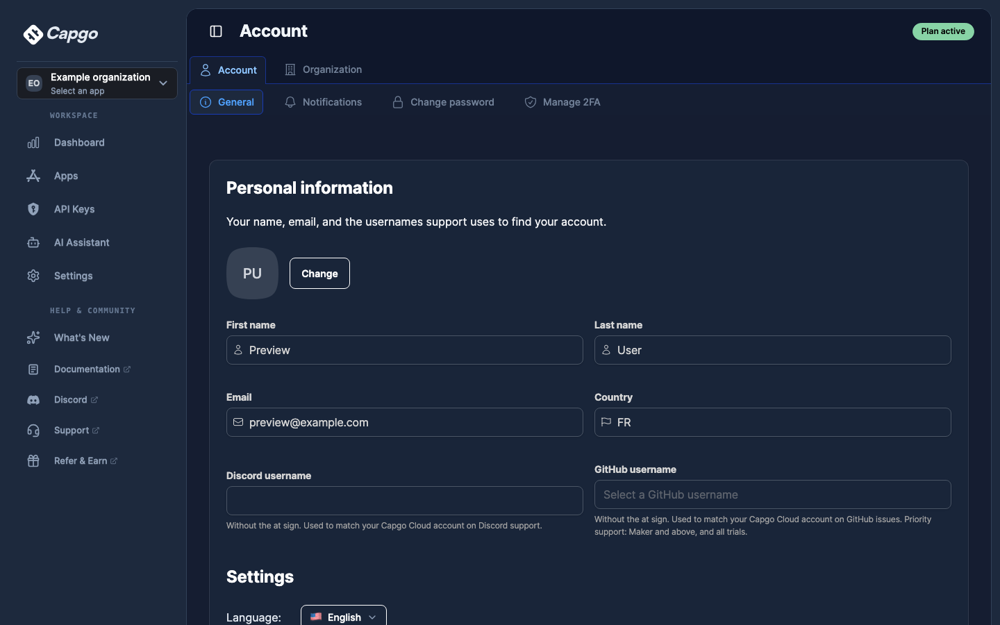
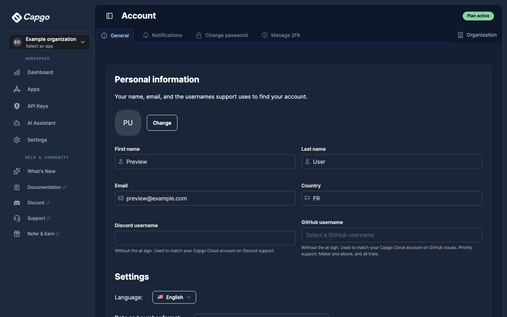
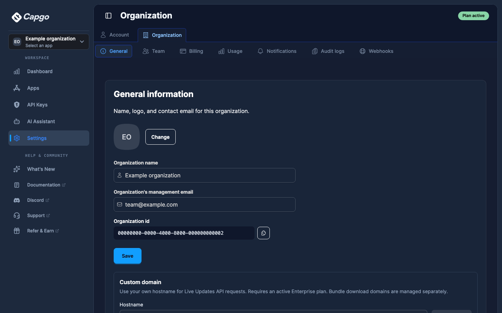
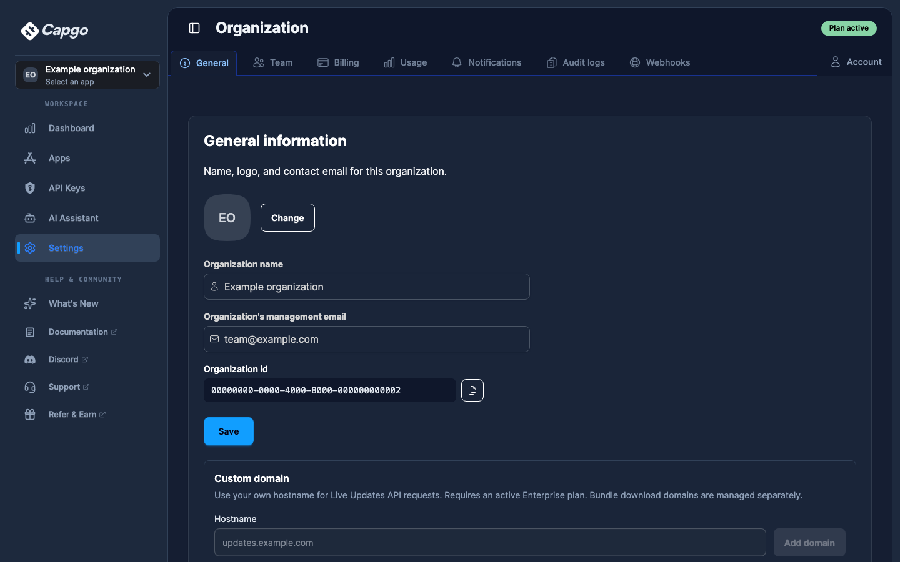
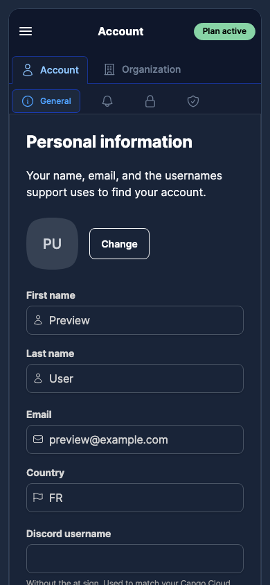
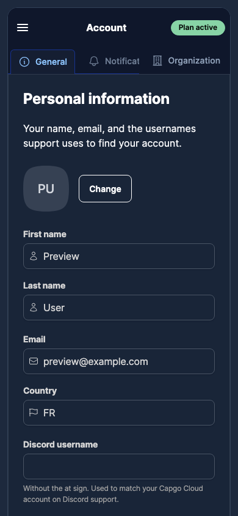
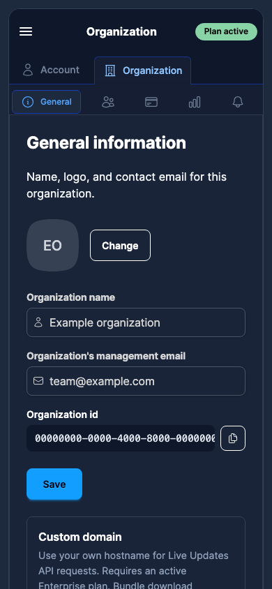
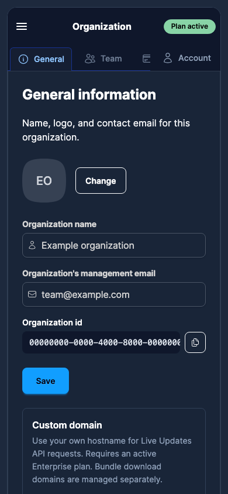

# Separate account and organization settings

The shared Account / Organization tab row is removed. Each section now starts
with its own tabs, with a link to the other section beside them. Existing URLs,
sidebar/profile entry points, and nested Team / Billing destinations are preserved.

Screenshots use the real settings layout, general pages, sidebar and navbar,
mounted in a local browser fixture with synthetic account/organization data and
stubbed backend responses. They are component previews, not authenticated backend
end-to-end captures. Before uses the layout from d881110599; after uses this PR.
Desktop viewport: 1440 × 900. Mobile viewport: 390 × 844. Dark appearance.

| Section | Before | After |
| --- | --- | --- |
| Account |  |  |
| Organization |  |  |
| Account, mobile |  |  |
| Organization, mobile |  |  |

Browser checks covered both cross-links, account tabs, Team and Billing children,
back/forward navigation, direct reloads, navigation at 390px and 320px without
horizontal document overflow, and leaving an organization blocked by 2FA through
the Account link. No browser page errors were observed.
